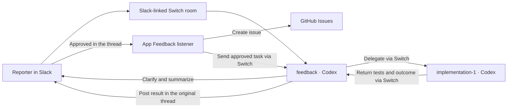

# App Feedback

**Flip the Switch · Best Business Workflow**

App Feedback turns a Slack bug report into a GitHub issue and hands it to a coding agent. The reporter can clarify the problem, approve the agreed behavior, and follow the outcome in the original Slack thread.

## How we use Switch



- **`feedback`** clarifies the report in plain language, summarizes the requested behavior, and coordinates the handoff and result.
- **`implementation-1`** works in a separate checkout, reproduces the issue, makes the fix, and runs regression tests.
- **App Feedback listener** joins the same room as `app-feedback-f1-probe`. It checks the sender of the approval and matches it to the feedback agent's summary in that thread. It creates the GitHub issue and sends the approved task to `feedback`.

Switch connects the Slack conversation to both local Codex agents and routes the request and the result in the original thread. GitHub holds the issue and PR.

## What the demo proved

In Taskroom, filtering the Atlas project to **Completed** showed three tasks, but the CSV preview contained all ten. The Slack run created issue #4, assigned the fix, and returned the worker's result to the original thread. The worker fixed the export filter and passed all eight regression tests across Atlas and Orbit. The worker's GitHub push was blocked by automatic approval review, so the operator used a separate Codex session to publish the tested commit and open PR #2. The PR is open for review and links to the issue. [GitHub issue #4](https://github.com/greeshmanthvarma/switch-ai-hackathon-app-feedback/issues/4) · [GitHub PR #2](https://github.com/greeshmanthvarma/switch-app-feedback-target/pull/2)

## Set up and run

You need Node.js 22.19 or newer on the Node 22 line, the GitHub CLI signed in, Switch Console with Codex, a Slack bridge, and private GitHub repositories for the tracker and target. The live listener was tested with Switch 0.31.0 and agent protocol 9.

1. Run `npm ci` in this repository. Prepare the Taskroom target and run it from the `demo/atlas-workspace` baseline with `npm ci` and `npm run dev`. Give the worker a separate clean worktree of the same private target repo. [Taskroom baseline](https://github.com/greeshmanthvarma/switch-app-feedback-target/tree/demo/atlas-workspace)
2. In Switch Console, use the [room template](config/app-feedback.template.yaml) to create the room and agents, or configure an existing Slack-linked room using the [agent instructions](docs/integration/agent-instructions.md). Select the Slack bridge and enter the two working directories when using the template. Register the listener, add it to the room, and start it with your own sender IDs, tracker, and target. [Setup and launch commands](docs/integration/operator-demo.md)
3. In Taskroom, select **Atlas → Completed → Preview CSV**. In Slack, send `@feedback report: The CSV preview for Atlas isn’t showing what I expected.` When asked, explain that the preview should show the same three completed tasks as the page.
4. Reply **Approved** in the same Slack thread after `feedback` posts its **Ready for approval** summary. Confirm the issue is created, watch the Switch handoff, and check the worker's test result in the thread. If the worker's runtime blocks publication, review the tested commit and publish it from an authorized session.

The template provides the room and two Codex agents. The Slack connection, service registration, and GitHub access are configured separately. The checked-in fixtures use sanitized data.

## Verify locally

```sh
npm ci
npm test
npm run typecheck
npm run format:check
```
